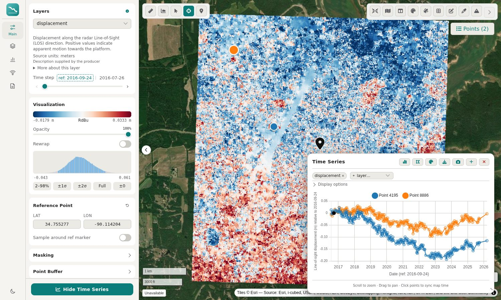
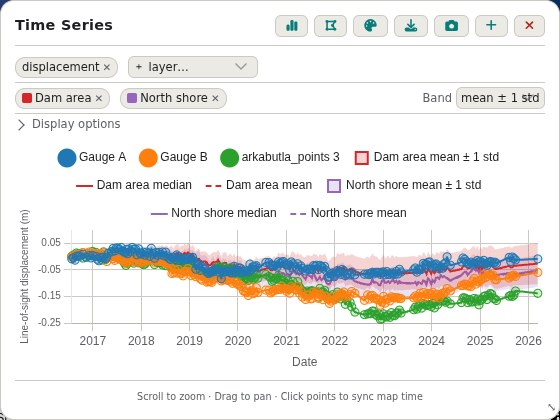
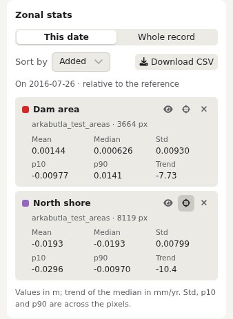

# Bowser

Map-based viewer for InSAR time-series outputs — GeoZarr cubes, dolphin workflow directories, or loose GeoTIFFs — served through a local FastAPI server and rendered by titiler in the browser.



## What you can do

- **Browse the cube in time.** Step through dates with ‹ ›, click an arrow again to play forward or backward, and right-click it to set the speed.
- **Reference in space and time.** Pick a reference point, or the median of a circle around it. Click **ref: <date>** beside the time step to show every pixel and series relative to another date; each series' point on that date is marked in the chart.
- **Plot time series.** Click the map to add points. Fit a model (polynomial, seasonal terms, steps), show residuals, compare several layers on separate y axes, and style each series from the chart's palette button.
- **Area statistics.** Add a drawn or loaded polygon to the chart with the area button: median, dashed mean and a mean ± 1 std or p10–p90 band.
- **Zonal statistics for your own files.** Load a GeoJSON, KML, GPX, CSV or shapefile (.shp with its sidecar files, or zipped) under Overlays and click its chart icon: each polygon becomes a chart area and each point a time series, in the same colour on the map and in the chart. The **Stats** tab lists mean, median, std, p10, p90 and trend per area, with a CSV download.
- **Understand each layer.** The layer's description, from the producer's metadata when it has one, shows under the layer selector; the (i) button hides or shows it. See [layer information](docs/layer-information.md).
- **Export.** Download the current layer as a GeoTIFF with the masks and reference applied, with progress and Cancel. The file records its [dates, source, masks and reference](docs/geotiff-export-provenance.md).
- **Raster GIF.** On the full server, export a bounded saved-epoch range with fixed color limits, named quality masks and native references. See [supported settings and limitations](docs/raster-animation.md); map backgrounds and linked plots are separate work.
- **Context.** Satellite, topographic, relief and hillshade basemaps, 3D terrain, GNSS stations (UNR, or [your own CSV files](docs/gnss.md)), geology, land cover, drawing and measuring tools.
- **Ask an AI assistant.** `bowser mcp` gives Claude Desktop, Claude Code and other MCP clients tools for time series, trends, profiles and statistics from a running Bowser server. See [MCP server](docs/mcp.md).

The full server and bowser-lite also provide a [polygon statistics API](docs/polygon-statistics.md) for stored raster values.

<p>
  
  
</p>

## Download

- **Desktop app** for macOS (Apple silicon and Intel), Windows and Linux: [latest release](https://github.com/opera-adt/bowser/releases/latest). No Python needed. It opens local `.zarr` or `s3://` cubes with bowser-lite: area statistics and GeoTIFF export work, GeoTIFF upload needs the full server. The apps are not signed yet; see [opening the app the first time](#opening-the-desktop-app-the-first-time).
- **Python package:** [`bowser-insar` on PyPI](https://pypi.org/project/bowser-insar/).
- **Docker image:** [`ghcr.io/opera-adt/bowser`](https://github.com/opera-adt/bowser/pkgs/container/bowser).
- **All releases and changes:** [Releases](https://github.com/opera-adt/bowser/releases) and the [changelog](CHANGELOG.md).

### Opening the desktop app the first time

The apps are not signed yet, so macOS and Windows ask before running them.

- **macOS:** open the `.dmg`, drag **Bowser** to **Applications**, then run this once in Terminal:

  ```bash
  xattr -dr com.apple.quarantine /Applications/Bowser.app
  ```

  It removes the "downloaded from the internet" mark that makes macOS refuse the app (also when it says Bowser "is damaged and can't be opened"). Without Terminal: open Bowser once, then allow it under **System Settings › Privacy & Security › Open Anyway**.
- **Windows:** if SmartScreen warns, choose **More info**, then **Run anyway**.

## Quickstart

Zero-install — run the latest release against a GeoZarr cube:

```bash
uvx --from bowser-insar bowser run --stack-file example-cube.zarr
```

Open the `http://127.0.0.1:8000` link that bowser prints.

> **Note on PyPI installs and GDAL**: The PyPI wheel is enough for GeoZarr cubes
> and plain GeoTIFFs. For other input formats, `pixi` is the easiest way:
>
> ```bash
> pixi global install bowser-insar
> ```

**Installation in another project**

```bash
# GeoZarr / GeoTIFF only
pip install bowser-insar       # or: uv add bowser-insar

# Full format support (NetCDF, HDF5, VRT) via conda-forge GDAL
pixi add bowser-insar
```

## Quickstarts

### From [`dolphin`](https://github.com/isce-framework/dolphin)

`bowser setup-dolphin` scans a dolphin work directory and writes a
`bowser_rasters.json` describing every raster group it finds. `bowser run`
then serves them.

```bash
bowser setup-dolphin work/
bowser run
```

**Note:** these outputs must be **geocoded** to work with bowser, which lays them out on a basemap using web mapping tools.

If you're running over ssh, tunnel the port back to your laptop:

```bash
ssh -N -L 8000:localhost:8000 myserver
```

### From [`dolphin`](https://github.com/isce-framework/dolphin) → GeoZarr cube

Once the `bowser_rasters.json` file is created, you can convert the data into a GeoZarr cube:

```bash
pixi run -e writer bowser tifs-to-geozarr \
    --pyramid bowser_rasters.json cube.zarr
```

### DISP-S1 → GeoZarr cube

To work with DISP-S1 products, you may convert them once into a single pyramidal GeoZarr cube, then serve that. The converter handles the reference-date bookkeeping for a moving temporal reference, builds multiscale pyramids, and writes GeoZarr convention attributes so titiler can pick the right overview per tile zoom.

```bash
# 1. prepare per-band GeoTIFFs and a bowser_rasters.json
bowser setup-disp-s1 /path/to/disp-s1/outputs

# 2. convert to a single sharded GeoZarr cube with pyramid
pixi run -e writer bowser tifs-to-geozarr \
    --pyramid bowser_rasters.json cube.zarr

# 3. serve
bowser run --stack-file cube.zarr
```

For a **multi-dataset catalog** (pick from a map of bounding boxes at startup) and an **EC2 deployment** serving cubes from a private S3 bucket, see [`deploy/README.md`](deploy/README.md) for the `bowser register` CLI, the Docker image, and the EC2 bootstrap script end-to-end.

## GeoTIFF exports and spatial reference

On the full server (`bowser run`), the Export panel saves native-resolution layer
values, with the active masks and selected point or median-area reference
applied. The reference value is
sampled from the original layer at the selected date, before optional display
masks, just as in the reference controls. Valid zeros remain valid; masked or
source-nodata pixels remain nodata. Source files are never modified.

For reference-enabled layers, the GeoTIFF records the requested WGS84 position,
buffer radius, number of valid reference pixels, value subtracted, and operation
in `BOWSER_REFERENCE_*` metadata tags. Disabling spatial referencing exports
stored values. Layers without spatial referencing, such as quality masks, are
not shifted. Median-area export currently requires a projected grid in meters;
geographic grids support point references. An invalid or empty reference raises
an error rather than silently exporting a different reference.

API clients can pass `ref_lon`, `ref_lat`, and optionally `ref_buffer_m` to
`/export/geotiff`. Omitting these parameters preserves the stored reference.
`ref_time_idx` exports the step relative to another date, as the viewer's
"ref: <date>" menu shows it on the map (GeoZarr cubes).
Export values are not colorized, rewrapped, or converted between units.

## GPU rendering (experimental)

Add `?render=gpu` (or `?render=auto`, which uses the GPU only on a capable
hardware GPU) to the page's address to draw the data layer in the browser's GPU
from the cube's own chunks instead of server tiles: dates, colormaps, ranges
and reference dates then change in a frame. Without it nothing changes. See
[docs/gpu-render.md](docs/gpu-render.md) for what it draws, what stays on tiles
and how to tell which renderer is active.

## CLI Usage

```bash
$ bowser --help
Commands:
  prepare-amplitude      Convert complex SLC GeoTIFFs to amplitude-in-dB.
  prepare-disp-s1        Create VRTs pointing into DISP-S1 NetCDFs.
  prepare-nisar-gunw     Create VRTs pointing into NISAR GUNW NetCDFs.
  register               Add a dataset entry to a catalog TOML file.
  run                    Run the web server.
  set-data               Specify what raster data to use (interactive).
  setup-aligned-disp-s1  Write bowser_rasters.json for aligned DISP-S1.
  setup-disp-s1          Write bowser_rasters.json for DISP-S1 outputs.
  setup-dolphin          Write bowser_rasters.json for a dolphin run.
  setup-hyp3             Write bowser_rasters.json for HyP3 Gamma.
  setup-nisar-gunw       Write bowser_rasters.json for NISAR GUNW.
```

## Developer setup

For the full/lite tile request convention and deterministic image tests, see
[map tile dimensions and regression images](docs/tile-request-contract.md).

```bash
git clone git@github.com:opera-adt/bowser.git && cd bowser
pixi install            # default env: runtime deps
pixi install -e writer  # optional env: includes geozarr-toolkit for the converter
pixi run bowser run
```

Frontend (TypeScript + Vite):

```bash
npm install
npm run build   # rebuilds src/bowser/dist/ after .tsx / CSS changes
```

The PyPI wheel bundles `src/bowser/dist/` (built by the CD workflow before publishing), so end users can `pip install bowser-insar` without Node. From a git checkout, run `npm run build` first to populate `src/bowser/dist/` before `pip install -e .`.

For a hot-reload loop on UI/styling changes, run the backend and the
Vite dev server in two terminals. Vite proxies API calls to the
backend on port 8000:

```bash
# Terminal 1 — backend
pixi run bowser run

# Terminal 2 — frontend with HMR on http://localhost:5173
npm run dev
```

Override the backend URL with `VITE_API_URL=http://localhost:8001 npm run dev`.

## Legacy workflows

### DISP-S1 via VRTs (pre-GeoZarr)

The older path is to make a GDAL VRT per NetCDF variable and let bowser
read through those. This predates `bowser tifs-to-geozarr` and has
two drawbacks: remote NetCDF/HDF5 reads are slow (no standard overview
format), and VRTs require a conda-forge GDAL with the NetCDF driver.

Kept working, but prefer the GeoZarr path above for new setups.

```bash
mkdir my_disp_files; cd my_disp-files
s5cmd --numworkers 4 cp 's3://opera-bucket/OPERA_L3_DISP-S1_IW_F11115*/*.nc' .
bowser prepare-disp-s1 -o vrts *.nc
bowser setup-disp-s1 vrts
bowser run
```

## License

Copyright 2024, by the California Institute of Technology. ALL RIGHTS RESERVED. United States Government Sponsorship acknowledged. Any commercial use must be negotiated with the Office of Technology Transfer at the California Institute of Technology.

This software may be subject to U.S. export control laws. By accepting this software, the user agrees to comply with all applicable U.S. export laws and regulations. User has the responsibility to obtain export licenses, or other export authority as may be required before exporting such information to foreign countries or providing access to foreign persons.
